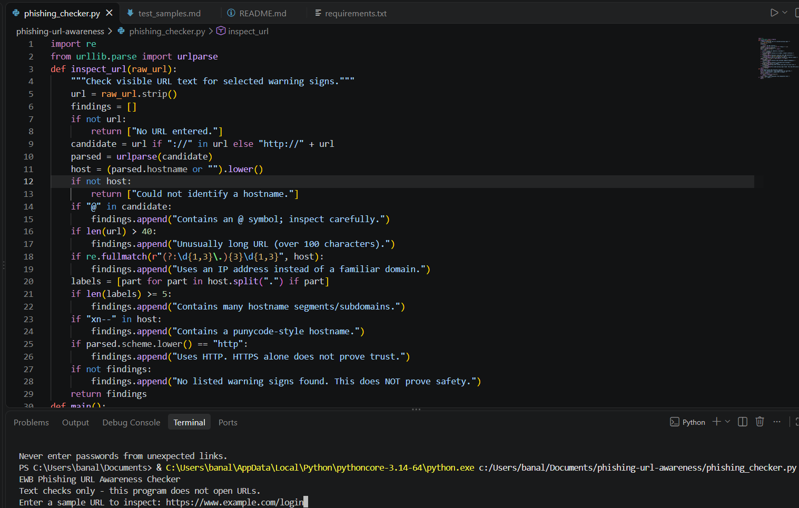
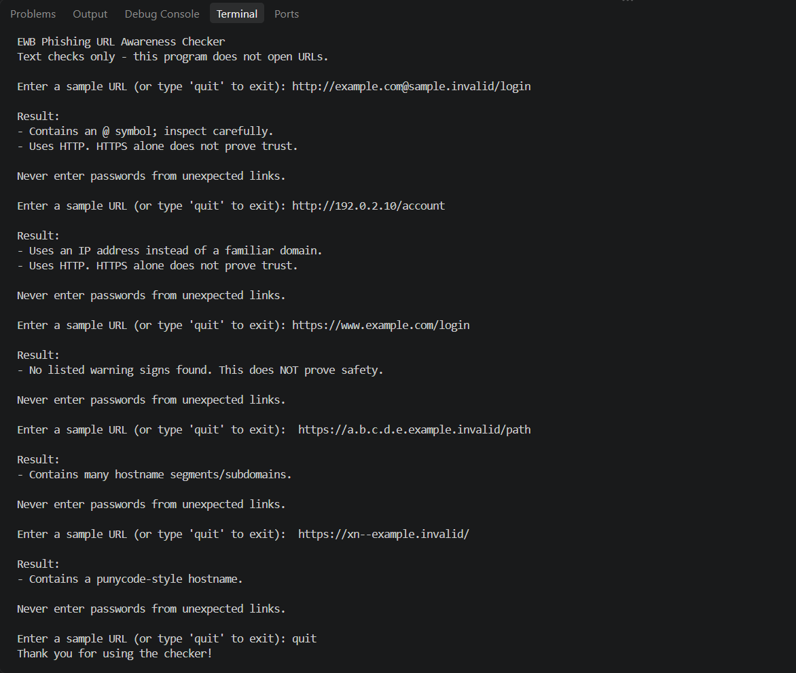

# 🛡️ Phishing URL Awareness Checker


## 📌 01. Project Overview

The **Phishing URL Awareness Checker** is a Python-based cybersecurity project designed to identify common warning indicators that may be associated with suspicious or phishing-related URLs.

Phishing is a cyberattack technique in which attackers use deceptive links to trick users into visiting fraudulent websites and potentially revealing sensitive information such as login credentials, banking details and personal data.

This project provides a simple command-line application that analyses URL text using predefined security checks. It identifies selected suspicious URL characteristics and displays warning messages to improve user awareness.

> 🔒 **Security Principle:** This application performs text-based URL analysis only. It does not visit websites, establish network connections or send information to external services.

---

## 🎯 02. Project Objectives

The primary objectives of this project are:

* Identify suspicious URL patterns.
* Detect the presence of the `@` symbol.
* Identify URLs containing IP addresses.
* Detect unusually long URLs.
* Identify hostnames containing multiple segments.
* Detect Punycode-style hostnames containing `xn--`.
* Identify URLs using the HTTP protocol.
* Improve awareness of suspicious links through understandable warning messages.

---

## ⚙️ 03. Technologies and Tools

| Technology                | Purpose                                      |
| ------------------------- | -------------------------------------------- |
| Python 3.14               | Main programming language                    |
| Visual Studio Code        | Application development                      |
| `re`                      | Regular-expression-based IP address checking |
| `urllib.parse`            | URL parsing and hostname extraction          |
| Command Prompt / Terminal | Application execution and testing            |
| GitHub                    | Project hosting and version presentation     |

**Dependencies:** The application uses Python's built-in standard-library modules. No additional third-party packages are required.

---

## 🚀 04. Key Features

### 1. @ Symbol Detection

Checks whether the supplied URL contains an `@` symbol, which can sometimes be used in deceptive URLs.

### 2. IP Address Detection

Identifies hostnames that match an IPv4-style address instead of a conventional domain name.

### 3. Long URL Detection

Displays a warning when the URL exceeds 100 characters.

### 4. Multiple Hostname Segment Detection

Checks the hostname for five or more dots and displays a warning when this condition is detected.

### 5. Punycode Detection

Identifies hostnames containing the `xn--` prefix, which is used in ASCII-compatible representations of internationalised domain names.

### 6. HTTP Protocol Detection

Identifies URLs beginning with HTTP and displays a warning about the use of an unencrypted protocol.

### 7. Interactive Command-Line Interface

Allows users to inspect multiple URLs during one execution session.

### 8. Exit Option

Users can type `quit` to terminate the application.

---

## 🧠 05. Working Methodology

The application follows a simple URL inspection workflow.

```text
        ┌──────────────────────┐
        │      Start Tool      │
        └──────────┬───────────┘
                   │
                   ▼
        ┌──────────────────────┐
        │   Enter Sample URL   │
        └──────────┬───────────┘
                   │
                   ▼
        ┌──────────────────────┐
        │     URL Parsing      │
        └──────────┬───────────┘
                   │
                   ▼
        ┌──────────────────────┐
        │   Perform URL Checks │
        └──────────┬───────────┘
                   │
                   ▼
        ┌──────────────────────┐
        │  Display Findings    │
        └──────────┬───────────┘
                   │
                   ▼
        ┌──────────────────────┐
        │  Enter Another URL?  │
        └──────────┬───────────┘
                   │
             Yes   │   No / quit
              ┌────┴────┐
              ▼         ▼
           Inspect    Exit Tool
           Another
             URL
```

The application uses URL parsing, conditional statements and regular expressions to perform its predefined checks.

---

## 📁 06. Project Structure

```text
phishing-url-awareness-checker/
│
├── phishing_checker.py
│
├── README.md
│
├── requirements.txt
│
├── tests/
│   └── test_samples.md
│
└── screenshots/
    ├── sample_run.png
    └── test_results.png
```

| File / Folder         | Description                                  |
| --------------------- | -------------------------------------------- |
| `phishing_checker.py` | Main Python application and inspection logic |
| `README.md`           | Project documentation                        |
| `requirements.txt`    | Dependency information                       |
| `tests/`              | Sample testing documentation                 |
| `test_samples.md`     | Five sample test cases and their results     |
| `screenshots/`        | Application and testing evidence             |
| `sample_run.png`      | Application execution screenshot             |
| `test_results.png`    | Testing evidence screenshot                  |

---

## 💻 07. Installation and Execution

### Prerequisites

* Python 3.10 
* Visual Studio Code or another Python editor
* Command Prompt or terminal

### Step 1 — Open the Project

Open the project folder in Visual Studio Code.

### Step 2 — Open the Terminal

Select:

`Terminal → New Terminal`

### Step 3 — Execute the Program

Run the program
```

### Step 4 — Enter a URL

Enter a sample URL when the application prompts you.

### Step 5 — Exit

Type the following command to exit:

```text
quit
```

---

## 🧪 08. Testing and Validation

The application was evaluated using five sample URLs to verify the implemented warning checks.

| Test | URL Characteristic         | Expected Result         | Status |
| ---- | -------------------------- | ----------------------- | ------ |
| 01   | Normal example URL         | No listed warning signs | PASS   |
| 02   | IP address and HTTP        | IP and HTTP warnings    | PASS   |
| 03   | `@` symbol and HTTP        | `@` and HTTP warnings   | PASS   |
| 04   | Multiple hostname segments | Hostname warning        | PASS   |
| 05   | Punycode-style hostname    | Punycode warning        | PASS   |

### Testing Summary

| Metric           | Result |
| ---------------- | -----: |
| Total test cases |      5 |
| Passed           |      5 |
| Failed           |      0 |
| Overall result   |   PASS |

Detailed test inputs and actual outputs are documented in `tests/test_samples.md`.

---

## 📸 09. Screenshots and Evidence

### Application Execution



### Testing Results



---

## 🔧 10. Implemented Improvements

The application includes the following usability improvements:

1. **Repeated URL Inspection:** Users can inspect multiple URLs without restarting the application.
2. **Exit Functionality:** Users can terminate the program using the `quit` command.
3. **Readable Warning Messages:** The application displays understandable descriptions of detected URL characteristics.
4. **Security Reminder:** The application reminds users that text-based checks do not guarantee website safety.

---

## ⚠️ 11. Limitations

Although the project demonstrates basic URL inspection techniques, it has certain limitations:

* It performs predefined text-based checks only.
* It does not verify domain reputation.
* It does not connect to websites.
* It does not use external threat intelligence databases.
* It does not analyse webpage content or website behaviour.
* It cannot identify every phishing URL.
* A URL without detected warning indicators may still be malicious.

Therefore, this application should be considered a basic cybersecurity awareness tool, not a complete phishing detection solution.

---


## 🏁 12. Conclusion

The **Phishing URL Awareness Checker** demonstrates how Python programming concepts can be applied to a basic cybersecurity awareness problem.

By implementing URL parsing, regular expressions and conditional checks, the project identifies selected warning indicators associated with suspicious URLs.

The project also provides practical experience in Python development, cybersecurity fundamentals, testing, technical documentation and GitHub repository management.

---

## 👨‍💻 Project Information

| Field                   | Details                          |
| ----------------------- | -------------------------------- |
| Project Title           | Phishing URL Awareness Checker   |
| Domain                  | Cybersecurity                    |
| Programming Language    | Python                           |
| Development Environment | Visual Studio Code               |
| Project Type            | Cybersecurity Awareness Tool     |
| Repository              | `phishing-url-awareness-checker` |


